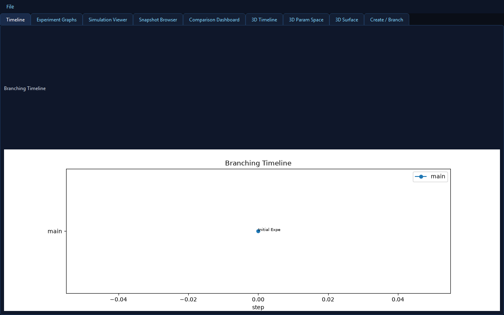
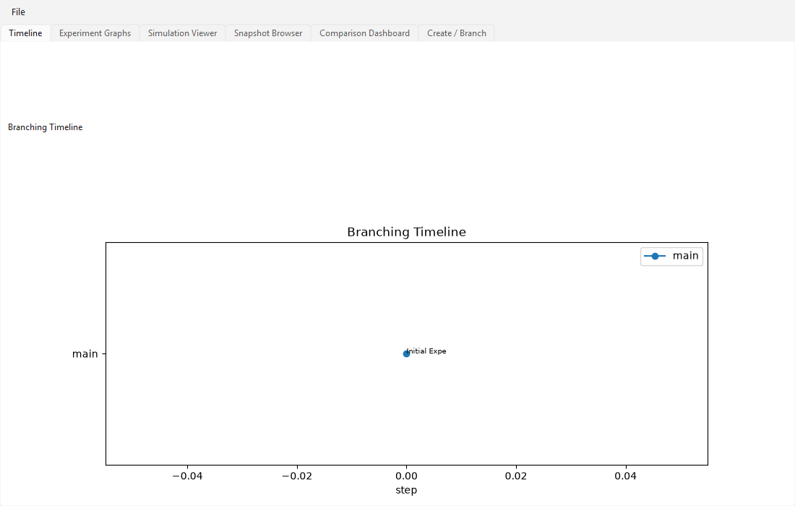
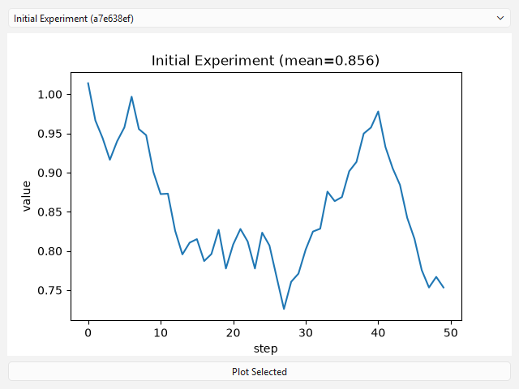
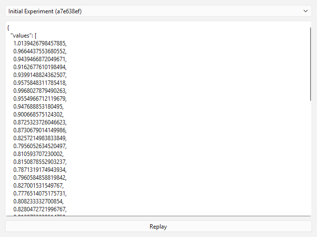

# SCIENTIFIC TIME MACHINE

**Version control for computational experiments.** Scientific Time Machine lets researchers create persistent experiment snapshots, branch from previous experiments, modify conditions, and compare alternative outcomes without destroying the original history.



## Overview

Scientific Time Machine is a PySide6 desktop application implementing a Git-like branching model for scientific experiments. Every experiment is stored as an immutable, content-addressed snapshot with a deterministic random seed, parameter set, and integrity hash. Researchers can replay simulations deterministically, compare branches, restore prior states, and export reproducible experiment packages.

## Key Features

- **Persistent snapshots** - SHA-256 content-addressed blobs + SQLite index, with integrity verification on every restore
- **Branching histories** - create branches from any experiment; branch independence is enforced by design
- **Parameter versioning** - every snapshot versions seed, params, state, and metadata
- **Deterministic random seeds** - reproducible simulation replay verified by tests
- **Simulation replay** - deterministic simulation engine with replay verification
- **Branch comparisons** - parameter diffs + metric diffs between any two experiments
- **State restoration** - restore any snapshot by hash with full integrity check
- **Reproducible packages** - zip export/import of single experiments and whole branches
- **Corruption recovery** - rebuild index from blobs, recover corrupt snapshots from alternate copies
- **History reconstruction** - rebuild experiment index from blob store
- **PySide6 desktop UI** - branching timeline visualization, experiment graphs, simulation viewer, snapshot browser, comparison dashboard

## Screenshots

| Timeline | Graphs |
|---|---|
|  |  |

| Simulation | Snapshots |
|---|---|
|  |  |

## Installation

### Windows executable (recommended)

Download `ScientificTimeMachine-win.zip` from the [v1.0.0 release](https://github.com/Nortaq-PlayNexus/ScientificTimeMachine/releases/tag/v1.0.0), extract, and run:

```
dist/ScientificTimeMachine/ScientificTimeMachine.exe
```

PyInstaller build - no Python required.

### Development installation

Requires Python 3.10+.

```
pip install PySide6 matplotlib pytest pytest-qt numpy
$env:PYTHONPATH="src"; python main.py
```

Data is stored in `%USERPROFILE%/.scientific_time_machine/`.

## Quick Start

1. Launch the application
2. Open the **Create / Branch** tab, set name, seed, steps, noise, base and click **Create Experiment**
3. Select the experiment as branch source, enter a branch name, click **Create Branch**
4. Use **Simulation Viewer** to replay, **Experiment Graphs** to plot, **Comparison Dashboard** to compare two experiments
5. Use **File > Export Selected Experiment Package** to create a reproducible zip package

## Testing

```
$env:PYTHONPATH="src"; python -m pytest -q
```

Current results: **8 passed**.

Tests cover: snapshot integrity, branch independence, replay reproducibility, corruption recovery, history reconstruction, package round-trip, comparison, UI smoke test.

## Architecture

See [docs/architecture.md](docs/architecture.md). Core engine under `src/scientific_time_machine/core/`, app controller in `app.py`, PySide6 UI in `ui/main_window.py`.

## Technology Stack

- Python 3.10+, PySide6, matplotlib (QtAgg), SQLite, PyInstaller
- pytest, pytest-qt

## Building the EXE

```
pip install pyinstaller
pyinstaller --noconfirm --windowed --name "ScientificTimeMachine" --paths src main.py
```

## Security & Integrity

- Snapshots are SHA-256 content-addressed; restore verifies both blob hash and experiment hash
- File > Check Integrity validates all blobs against the index
- No network access, no credential handling; experiment data stays local

## License

MIT - see [LICENSE](LICENSE).

## Repository

https://github.com/Nortaq-PlayNexus/ScientificTimeMachine
